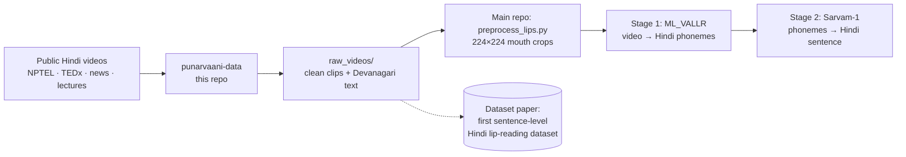
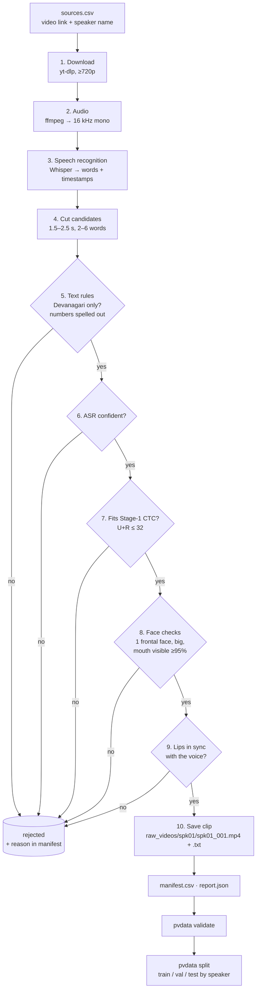
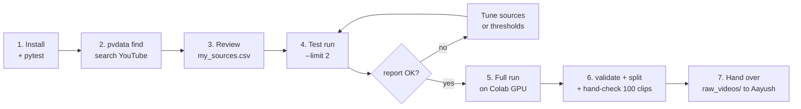

# Punarvaani Data Engine: the complete guide

> **Who this is for:** Kartikey (owner of the data part), the team, and anyone who asks "how did you build your dataset?"
> **What it covers:** why we build this dataset, how the pipeline works (with diagrams), what is coded and what isn't, what you have to do step by step, how to improve it, how it becomes a research paper, and interview questions with answers.
> Last updated: 3 Nov 2026.

---

## 1. The aim, in one paragraph

Punarvaani reads silent lip movements and turns them into Hindi speech. To train the lip reader (Stage 1, the VALLR-style video → phoneme model) we need **many short videos of people speaking Hindi, each with an exact transcript**. **No such public Hindi dataset exists**: the only Hindi lip-reading work we found uses small, word-level recordings. So we build one, automatically, from public videos.

That dataset is useful twice:
1. it trains our model;
2. it is a **research contribution of its own**: the first sentence-level Hindi audio-visual lip-reading dataset, which we plan to publish.



---

## 2. The research angle (why this is genuinely a contribution)

| | |
|---|---|
| **Gap** | Lip-reading datasets exist for English (LRS2, LRS3), Mandarin (CMLR) and a few European languages, but **not for Hindi at sentence level**. |
| **Our contribution** | 1. An open, reproducible pipeline that builds Hindi lip-reading data from public video. 2. The dataset itself, with speaker-disjoint splits. 3. Baseline results from our Stage-1 model on it. |
| **Research questions** | RQ1: How much clean, frontal, in-sync Hindi speech can be mined from public video, and what filters it out? RQ2: How accurate are automatic Hindi transcripts for lip-reading labels? RQ3: How well does a VALLR-style model read Hindi lips when trained on this data? |
| **What we must not claim** | The pipeline *idea* is not new: LRS3 and Auto-AVSR built English datasets the same way. Our novelty is the **language, the data, and the benchmark**. |
| **Where to publish** | NeurIPS Datasets & Benchmarks, Interspeech, ICASSP, LREC-COLING, or *Scientific Data* (Nature). |

---

## 3. How the pipeline works

### 3.1 The big picture



The checks run **cheapest first**: text checks take microseconds, face detection takes seconds. Most bad clips are dropped before the slow steps.

### 3.2 Each stage, in simple words

| # | Stage | What it does | Why | File |
|---|---|---|---|---|
| 1 | Download | Gets the video at 720p or better, and saves licence/channel/title | TEAM_GUIDE needs ≥720p; licence is needed for the paper | `media.py` |
| 2 | Audio | Extracts 16 kHz mono sound | What speech models expect | `media.py` |
| 3 | Speech recognition | Whisper writes what is said, **with the start and end time of every word** | The transcript becomes the label; the timings let us cut clips exactly | `asr.py` |
| 4 | Cut candidates | Groups consecutive words into 1.5–2.5 s pieces, never across a long pause | Stage 1 samples 16 frames, so clips must be short | `segment.py` |
| 5 | Text rules | Devanagari only, numbers as words (`२०२५` → `दो हज़ार पच्चीस`), punctuation removed except `।` | The TEAM_GUIDE transcript rules | `text_norm.py` |
| 6 | ASR confidence | Drops a clip if Whisper was unsure of any word | A wrong label teaches the model wrong things | `pipeline.py` |
| 7 | CTC length | Converts the text to phonemes **with the trainer's own G2P** and checks U + R ≤ 32 | The trainer would silently drop longer clips anyway | `ctc.py`, `g2p/` |
| 8 | Face checks | MediaPipe finds the face in every frame: exactly one face, turned/tilted ≤ 20°, face ≥ 18% of frame height, mouth ≥ 40 px, in ≥ 95% of frames | Lips must be clearly visible from the front | `face.py` |
| 9 | Sync | Does the mouth open when the voice is loud? (correlation, within ±0.2 s) | Removes dubbing, voice-over and B-roll | `sync.py` |
| 10 | Save | Writes the clip (720p, 25 fps) and transcript, logs every decision | Exactly the format Aayush's trainer reads | `export.py` |

### 3.3 What comes out

```
dataset/
├── raw_videos/spk01/spk01_001.mp4 + spk01_001.txt   ← for the trainer
├── manifest.csv      every candidate: source, licence, times, text, scores, accepted/rejected + reason
├── report.json       totals, hours, clips per speaker, rejections by reason, clips per licence
├── speakers.json     spk01 → the name you used
├── splits.json       which speakers are train / val / test (never the same person in two)
└── splits/           train/ val/ test/ folders (symlinks)
```

### 3.4 Key design decisions (and why)

| Decision | Why |
|---|---|
| Speaker-disjoint splits | If one person appears in both train and test, the score measures memorising faces, not reading lips |
| Every rejection logged with a reason | Lets us tune the filters, and the rejection funnel is a result in the paper |
| Same G2P file as the trainer | Our length check gives exactly the trainer's answer |
| Resumable (cache + `done/` markers) | Long runs crash or get interrupted; nothing is redone |
| Light sync check instead of SyncNet | No extra model or GPU needed; good enough to catch voice-overs. SyncNet is a planned upgrade |
| Clips not videos in the paper release | Copyright: publish IDs + timestamps + transcripts, like LRS3 and VoxCeleb |

---

## 4. What is done and what is not

### Coded and tested

| Part | Status |
|---|---|
| Sources CSV, speaker IDs, `pvdata find` (YouTube search → CSV, one speaker per video for TEDx/NPTEL) | ✅ |
| Download + audio + licence metadata | ✅ coded (needs a real run) |
| Whisper backends: faster-whisper, WhisperX, Hugging Face (IndicWhisper) | ✅ coded (needs a real run) |
| Segmentation, text rules, Hindi number words, CTC check | ✅ tested |
| Face checks (MediaPipe) and sync check | ✅ tested (face check also on a real photo) |
| Export, manifest, report, validate, speaker-disjoint split | ✅ tested |
| First real run (college PC, RTX A5000): 39 videos → 2,576 clips, 1.41 h, 15 speakers | ✅ done |
| Speed-ups: parallel checks, early face rejection, 720p decoding and download, background download | ✅ |
| **Autopilot** `pvdata auto`: discover → screen (3 × 20 s samples) → mine → expand good channels, per-channel caps | ✅ coded, tested offline |
| **Identity** `pvdata identify`: face embeddings merge one person's videos, quarantine guests; person-safe split | ✅ coded, tested offline |
| CTC-aware clip boundaries (a fast speaker loses one word, not the clip) | ✅ |
| 42 automated tests, GitHub CI | ✅ |

**Honest limit:** the tests use a synthetic video and a fake speech recogniser, because YouTube isn't reachable from the build environment. **The first real run is the real test.** Expect to tune thresholds after it.

### Not done yet

| To do | Who / when |
|---|---|
| Find and review real videos (`my_sources.csv`) | **You, now** (section 5) |
| First real run on 2 videos; tune thresholds | You, then send `report.json` |
| Full run on a GPU (Colab/Kaggle) | You, by Fri |
| Hand-check ~100 random clips (transcript right? lips visible? in sync?) | Team, by Sat |
| Hand over `raw_videos/` to Aayush | Sat |
| Volunteer recordings (spoken **and** silent), with consent forms | After the first handover |
| Paper extras: datasheet, hand-verified test set, baselines | After training starts |

---

## 5. What you have to do, step by step



**1. Install** (once):
```bash
cd ~/punarvaani-data && source .venv/bin/activate
pytest -q                     # 42 passed
```

**2. Find videos:**
```bash
pvdata find --queries sources/speakers.csv --out sources/my_sources.csv --per-speaker 3
```
This searches YouTube for every row in `sources/speakers.csv` (journalists, teachers, NPTEL, TEDx, Josh Talks) and writes candidates with their channel, title and length in `notes`.

**3. Review every row in `sources/my_sources.csv`.** This matters more than any setting.

| Keep ✅ | Delete ❌ |
|---|---|
| One person talking to the camera | Panels, debates, interviews with cuts between people |
| Mostly Hindi | Mostly English or heavy Hinglish |
| Studio, desk or close stage shot | Compilations, slideshows, voice-over on pictures |
| Mouth always visible | Masks, mics in front of the mouth, side angles |

- Add `start`/`end` (e.g. `0:45`, `18:30`) to skip intros, ads and audience shots.
- Use the **same speaker name** if the same person appears in several videos.
- Aim for **10–20+ different speakers**, including women and different accents.

**4. Test run on 2 videos:**
```bash
pvdata run --sources sources/my_sources.csv --out ~/punarvaani_dataset --limit 2
pvdata report --out ~/punarvaani_dataset
```
- Open a few clips in `~/punarvaani_dataset/raw_videos/` and read their `.txt` files.
- Send the `report.json` output to the team (and to Claude) to tune.

**5. Full run on a GPU** (Whisper is slow on a laptop CPU):
```python
# Google Colab, Runtime → GPU
!git clone https://github.com/kartikeyagrawal2007/punarvaani-data && cd punarvaani-data && pip install -q -e ".[download,asr]" && apt-get -qq install -y ffmpeg
%cd punarvaani-data
# upload your reviewed sources/my_sources.csv first
!pvdata run --sources sources/my_sources.csv --out /content/drive/MyDrive/punarvaani_dataset
```
It's resumable: if Colab disconnects, run the same command again.

**6. Check and split:**
```bash
pvdata validate ~/punarvaani_dataset/raw_videos      # must end with OK
pvdata split --out ~/punarvaani_dataset
```
Then hand-check about 100 random clips: is the transcript right, are the lips visible, does it look in sync? Note the error rate; it's a number for the paper.

**7. Hand over** `raw_videos/` (via Google Drive, never public) to Aayush, who runs `scripts/preprocess_lips.py` in the main repo.

**Targets:** prototype 300–500 clips from 5–10 speakers; benchmark 1,500+ clips (TEAM_GUIDE). For the paper, aim much higher: thousands of clips, 50+ speakers.

---

## 6. How to make the pipeline better (ideas, in priority order)

| Improvement | What it fixes | Effort |
|---|---|---|
| **SyncNet** instead of the light sync check | More precise rejection of off-sync clips | Medium |
| **Two-ASR agreement** (Whisper + IndicWhisper must agree) | Fewer wrong transcripts, and a measurable label-quality score | Medium |
| ~~Face identity check~~ | Done: `pvdata identify` | ✅ |
| **Shot-cut detection** | Drops clips that cross a camera cut | Small |
| **Hinglish → Devanagari transliteration** (AI4Bharat IndicXlit) | Keeps clips with English loanwords instead of dropping them | Small |
| **Export mouth crops directly** (skip the second cropping pass) | Faster handover, one source of truth | Small |
| ~~Parallel processing~~ | Done: parallel checks + background download | ✅ |
| **Several PCs at once** (different seed lists, merge afterwards) | 100 h in days instead of a week | Medium |
| **Volunteer recording tool** (spoken + silent takes, consent) | The silent-speech subset, our most unique data | Medium |
| **Datasheet generator** from manifest + report | Paper-ready statistics in one command | Small |

**Note for Aayush (main repo, not this one):** the trainer's G2P (copied here unchanged) maps `द` to the retroflex `DD` and drops every inherent "a" (`कमल` → `K M L`). Hindi keeps most medial schwas (`kamal`), so fixing this would give cleaner phoneme labels. After he fixes it, copy the file here again.

---

## 7. Interview / viva questions (with short answers)

**Why build your own dataset?**
No public sentence-level Hindi lip-reading dataset exists. English has LRS2 and LRS3 (hundreds of hours), but Hindi only has small word-level sets.

**Where does the data come from, and is it legal?**
Public videos: NPTEL (Creative Commons), TED/TEDx (CC BY-NC-ND, research use) and other channels for research. We record the licence of every clip. For publication we share video IDs, timestamps and transcripts, not the videos, as LRS3 and VoxCeleb did.

**How do you get transcripts without typing them?**
Whisper speech recognition gives the text plus the start and end time of every word. We keep only clips where it is confident, then clean the text to our rules and hand-check a sample to measure the error rate.

**Why 1.5–2.5 second clips?**
Our Stage-1 model samples 16 frames and produces 32 CTC steps, so a clip's phonemes must fit (U + R ≤ 32). Short clips also give cleaner word alignment.

**What is U + R?**
U is the number of phoneme labels; R is the number of identical neighbours. CTC needs a blank between repeats, so a clip needs at least U + R output steps.

**How do you make sure the lips match the audio?**
We correlate how wide the mouth opens with how loud the voice is, frame by frame. Real speech correlates near zero time shift; dubbing and voice-overs don't.

**Why speaker-disjoint splits?**
Otherwise the test measures whether the model remembers a face, not whether it reads lips. Every person is in exactly one of train, val or test.

**Why reject clips with English words?**
The trainer's phoneme set is Hindi only, and mixed scripts give wrong labels. A later improvement is to transliterate English words into Devanagari.

**What's novel here? Isn't this just LRS3 for Hindi?**
The *method* follows LRS3 and Auto-AVSR, and we say so. The contribution is the first sentence-level Hindi lip-reading dataset, a reproducible open pipeline with Hindi-specific rules (number words, Devanagari normalisation, schwa-aware phoneme lengths), and the first Hindi benchmark results. Later we add the silent-speech subset, which is rare in any language.

**What are the limitations?**
Public videos are mostly *spoken aloud*, but patients mouth *silently*, and lips move differently then. That's why a volunteer silent subset and per-patient adaptation are planned. Also: automatic transcripts have some errors, and news and lecture speakers are not a perfect sample of all Hindi speakers.

**How do you know the filters work?**
Every decision is logged with a reason (`manifest.csv`), the funnel is summarised in `report.json`, and we hand-check a random sample. There are also 27 automated tests, including an end-to-end run on a synthetic video.

---

## 8. Glossary

- **ASR:** automatic speech recognition (Whisper turns speech into text).
- **Word timestamps:** the start and end time of each recognised word.
- **G2P:** grapheme-to-phoneme, turning written Hindi into sounds (phonemes).
- **Schwa deletion:** dropping the inherent "a" sound in some positions (`कमल` = "kamal", not "kamala").
- **CTC:** the training loss that lets the model output labels without exact timing.
- **Frontal / yaw / pitch:** facing the camera / head turned left-right / head tilted up-down.
- **Sync:** lips and audio happen at the same time.
- **Speaker-disjoint:** no person appears in more than one of train / val / test.
- **Manifest:** the log of every clip and decision.
- **Datasheet:** the standard description of a dataset (sources, licences, statistics, limitations) published with it.
